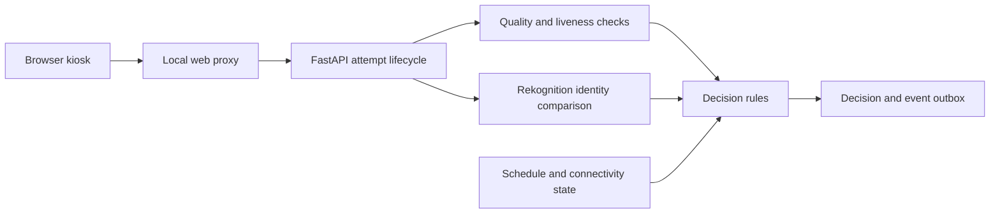

# HID Access Verification Kiosk

A camera-based access-verification prototype combining identity comparison, local image-quality checks, liveness challenges, schedule rules, and an offline event outbox.

**Stack:** Python · FastAPI · OpenCV · MediaPipe · PyTorch · AWS Rekognition · JavaScript · SQLite

[Demo guide](docs/DEMO.md) · [Decision contract](CONTRACT.md) · [Model provenance](pipeline/MODELS.md) · [Evaluation protocol](eval/PROTOCOL.md)

## Engineering highlights

- A central decision module combines evidence into approval, denial, or additional verification.
- A quick expression challenge and a step-up pose/expression flow evaluate prompted motion.
- Identity checks compare a claimed user with an enrolled reference.
- Schedule and online/offline state are evaluated in the decision path.
- An outbox stores decision events for later synchronization.
- A browser kiosk uses a local proxy server to communicate with the API.

## Architecture



## Local setup

A webcam, Python environment, model assets, and configured AWS credentials are needed for the full demo.

```bash
git clone https://github.com/sidd2006/Unemployed.git
cd Unemployed
python -m venv .venv
```

Activate the environment, then install the API and pipeline dependencies and fetch the model assets:

```bash
python -m pip install -r api/requirements.txt
python -m pipeline.fetch_third_party
```

Copy `.env.example` to `.env` and configure your own AWS region and credentials. Place consenting demo participants' enrollment references at `data/enrolled/<user_id>.jpg` (JPEG and PNG variants are also supported). Configure the corresponding schedule in [data/schedule.json](data/schedule.json).

Model sources, pinned upstream provenance, platform requirements, and calibration caveats are documented in [pipeline/MODELS.md](pipeline/MODELS.md).

Start the backend from the repository root:

```bash
python -m uvicorn api.main:app --port 8000
```

In a second terminal using the same environment:

```bash
python web/serve.py
```

Open [localhost:8765](http://localhost:8765) for the kiosk and [localhost:8000/docs](http://localhost:8000/docs) for the API reference. Startup may contact AWS for identity warm-up.

## Decision-rule tests

```bash
python -m unittest api.tests.test_decision
```

These exercise policy logic. A passing policy test is separate from a measured camera or anti-spoofing evaluation.

## Repository guide

| Path | Purpose |
| --- | --- |
| [api/main.py](api/main.py) | Attempt lifecycle and HTTP endpoints |
| [api/decide.py](api/decide.py) | Decision policy |
| [api/identity.py](api/identity.py) | Identity comparison and enrollment loading |
| [api/outbox.py](api/outbox.py) | Durable event queue |
| [pipeline](pipeline) | Quality, passive, motion, and challenge processing |
| [web](web) | Kiosk interface and local proxy |
| [eval](eval) | Calibration and evaluation tools |
| [docs/DEMO.md](docs/DEMO.md) | Rehearsal flow and evidence caveats |

## Validation status and scope

The recorded passive-only gate failed its target, so passive liveness is not sufficient for approval. The model notes and demo guide distinguish calibration from evaluation and retain the small-sample and untested-prop caveats.

This is a controlled demonstration prototype. Scores are model signals, not calibrated security probabilities. The current default flow is claimed-ID verification; the separate [identification proposal](web/IDENTIFY_API.md) documents functionality that should not be assumed implemented.
